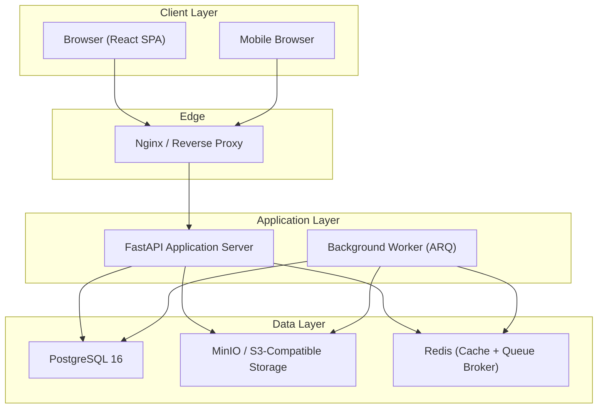
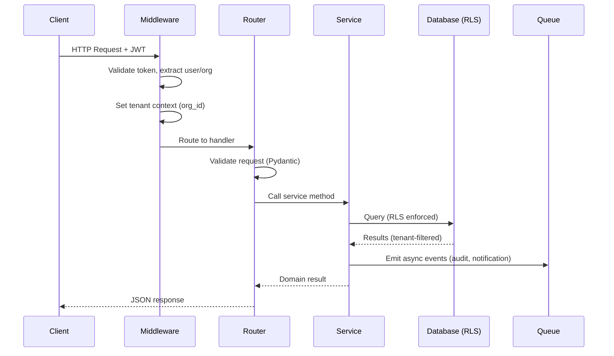
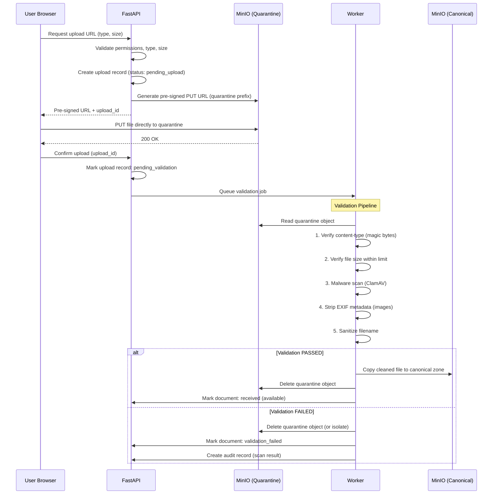
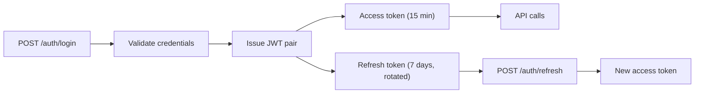
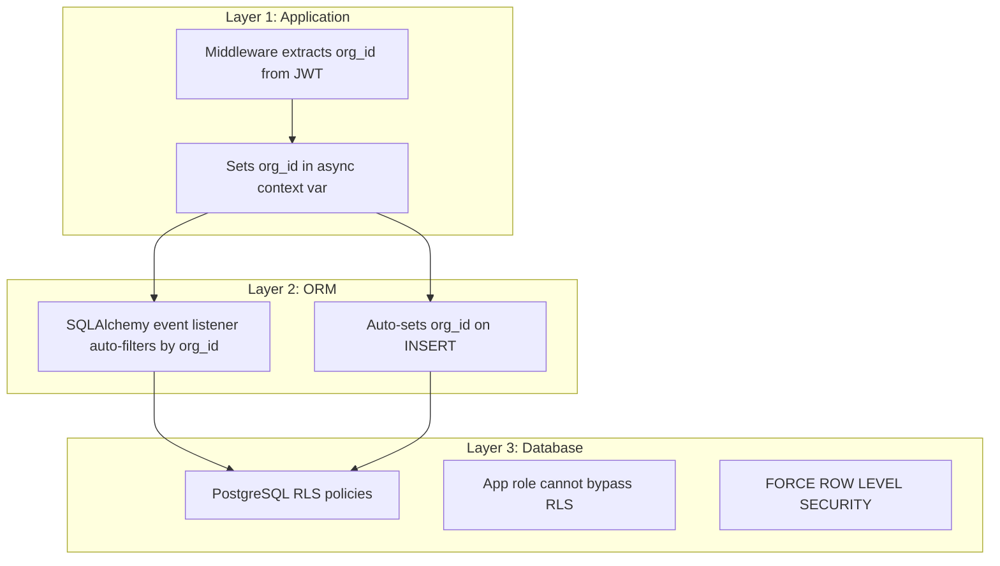
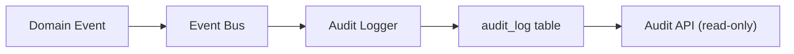
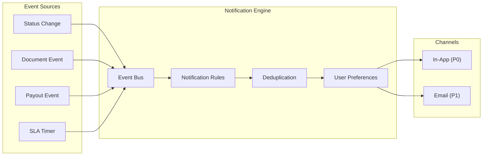
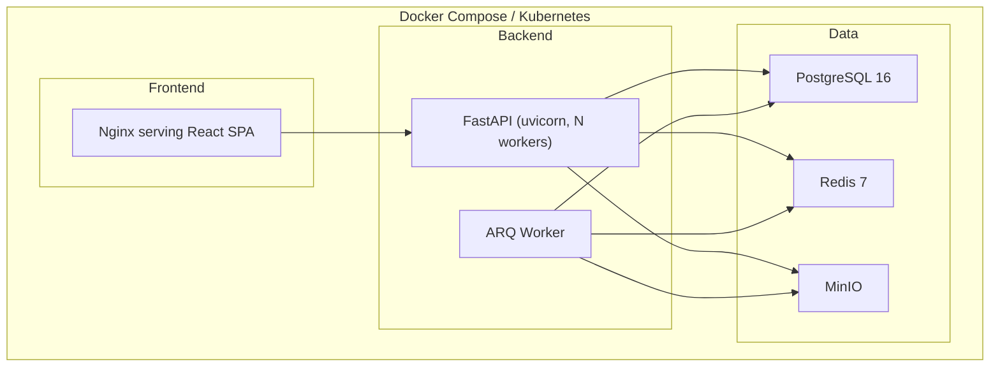

# DSA OS — Architecture

> Last updated: Planning phase
> Source of truth: PRD/SRS; this document captures architectural decisions for the implementation agent.

---

## 1. System Overview

DSA OS is a multi-tenant vehicle-loan operations platform built as a **modular monolith**. It serves DSA firms in India who source vehicle loans across multiple lenders. The system manages the full lifecycle from lead capture through payout reconciliation.



---

## 2. Frontend Architecture

### Technology

- **React 18+** with TypeScript
- **Vite** for build tooling
- **React Router v6** for routing
- **TanStack Query (React Query)** for server state management
- **Zustand** for lightweight client state (auth, UI preferences)
- **Vanilla CSS** with CSS custom properties (design tokens from Graphite Ledger system)

### Structure

```
frontend/
  src/
    app/                    # App shell, routing, providers
    features/               # Feature modules (co-located)
      auth/                 # Login, session, user management
      cases/                # Case list, detail, create, timeline
      parties/              # Party CRUD, search, duplicates
      vehicles/             # Vehicle panel
      documents/            # Checklist, upload, viewer
      lenders/              # Lender applications, side-by-side
      workflow/             # Status transitions, follow-ups
      pdd/                  # PDD board
      sources/              # Source management
      payout/               # Rules, expectations, reconciliation
      dashboard/            # Business overview, today view
      notifications/        # In-app notification center
      admin/                # Users, roles, settings, audit log
    shared/
      components/           # Design system components
      hooks/                # Shared hooks (useAuth, useTenant, usePermission)
      lib/                  # API client, formatters, validators
      types/                # Shared TypeScript types
    design-system/          # Tokens, base styles, component library
```

### Key Decisions

- **Feature-based co-location**: each feature owns its routes, components, hooks, and types
- **No business logic in components**: complex rules live in service modules or are enforced server-side
- **Optimistic locking**: version-aware forms that show conflict prompts on 409
- **INR formatting**: shared `formatINR()` utility using Indian digit grouping (e.g., `12,50,000`)
- **Offline form preservation**: `localStorage`-backed draft state with session-aware restoration

### Browser Draft Storage Policy

Only the following fields may be persisted in `localStorage` for offline draft preservation:

**Case Creation Draft:**
- `customer_name` (string) — not sensitive
- `mobile` (string) — necessary for form completion; not encrypted at rest in browser
- `product` (enum) — loan product type
- `source_id` (UUID) — reference to source
- `vehicle_condition` (enum) — new/used
- `requested_amount` (number) — loan amount

**Explicitly NEVER stored in browser:**
- PAN, Aadhaar (even partial)
- Password or authentication tokens (stored in httpOnly cookies or in-memory only)
- Bank account numbers
- Document file content or references
- Monthly income
- Date of birth

**Draft lifecycle:**
- Drafts are keyed by `draft:{user_id}:{form_type}`
- Drafts expire after 24 hours (TTL checked on restoration)
- Drafts are cleared on successful submission
- Drafts are cleared on logout
- Only one draft per form type per user
- **Mobile-first responsive**: 360px minimum; tables degrade to card lists on mobile

---

## 3. Backend Architecture

### Technology

- **Python 3.11.9**
- **FastAPI** with Pydantic v2 for request/response validation
- **SQLAlchemy 2.0** (async) as ORM
- **Alembic** for database migrations
- **ARQ** (async Redis queue) for background jobs
- **PyJWT** (`2.9.x`) with **cryptography** (`43.0.x`) for RS256 JWT tokens
- **passlib[argon2]** for password hashing
- **boto3** / **aioboto3** for S3-compatible object storage
- **python-multipart** for file uploads

### Module Structure (Modular Monolith)

```
backend/
  app/
    main.py                 # FastAPI app factory
    config.py               # Settings (pydantic-settings)
    database.py             # Engine, session, base model
    middleware/              # Tenant context, auth, rate limiting, CORS
    modules/
      auth/                 # Authentication, sessions, RBAC
        router.py
        service.py
        models.py
        schemas.py
        dependencies.py
      tenancy/              # Tenant isolation, RLS setup
      parties/              # Party CRUD, duplicate detection
      cases/                # Case lifecycle, state machine
      vehicles/             # Vehicle records
      documents/            # Checklist engine, upload, storage
      lenders/              # Lender applications, workflow
      workflow/             # Status transitions, SLA, follow-ups
      pdd/                  # PDD items, tracking
      sources/              # Sources, partners
      payout/               # Rules engine, expectations, reconciliation
      reports/              # Dashboard queries, KPI computations
      notifications/        # Event generation, channel dispatch
      privacy/              # Consent, retention, DSAR
      audit/                # Audit logging, search, export
      import_export/        # CSV/Excel import, export
    shared/
      models.py             # Base model with org_id, timestamps, soft delete
      schemas.py            # Common response schemas
      exceptions.py         # Domain exceptions
      security.py           # Encryption, masking utilities
      pagination.py         # Cursor and offset pagination
      events.py             # Internal event bus
    workers/
      tasks.py              # Background task definitions
      scheduler.py          # Periodic tasks (expiry checks, SLA, notifications)
  migrations/               # Alembic migrations
  tests/                    # Mirrors module structure
  seed/                     # Fictional demo data
```

### Request Flow



---

## 4. Database Architecture

### PostgreSQL 16

- **Row-Level Security (RLS)** on all tenant-scoped tables
- **Application role** (`dsaos_app`) that does NOT own tables and cannot bypass RLS
- **Migration role** (`dsaos_migrator`) for schema changes only
- **FORCE ROW LEVEL SECURITY** on all tenant tables to ensure even table owners cannot bypass
- **NUMERIC(14,2)** for all money values
- **TIMESTAMPTZ** for all timestamps; stored in UTC, displayed in IST
- **UUID v7** for primary keys (time-sortable)
- **Soft delete** via `deleted_at` column on business tables
- **Optimistic locking** via `version` integer column

### Schema Design Principles

1. Every business table has `org_id UUID NOT NULL REFERENCES organizations(id)` as the first column after `id`
2. Composite unique constraints include `org_id` (e.g., `UNIQUE(org_id, case_no)`)
3. Foreign keys enforce referential integrity
4. Check constraints enforce business rules at the database level where practical
5. Indexes on common query patterns: `(org_id, status)`, `(org_id, created_at)`, `(org_id, source_id)`

---

## 5. Object Storage Architecture

### MinIO (S3-compatible, self-hosted)

- **Private buckets only** — no public access
- **Two storage zones**:
  - **Quarantine zone**: `quarantine/{org_id}/{upload_id}/{filename}` — untrusted uploads land here
  - **Canonical zone**: `documents/{org_id}/{document_id}/v{version}/{filename}` — validated files only
- **Signed download URLs** generated ONLY for objects in the canonical zone; never for quarantine
- **Pre-signed PUT URLs** for direct upload from browser, targeting quarantine zone only
- **Server-side encryption** enabled (SSE-S3) on both zones
- **Quarantine cleanup**: abandoned quarantine objects deleted after 24 hours by scheduled worker
- **Separate IAM/policy**: `dsaos_app` has write access to quarantine zone and read/write to canonical zone; the browser pre-signed URL can only PUT to quarantine

### Upload Flow (Quarantine Model)



### Quarantine Rules

1. **No signed download URLs** may be generated for objects in the quarantine zone
2. **Document status `pending_upload` or `pending_validation`** blocks all download API calls
3. **Only documents with status `received` or later** are eligible for signed URL generation
4. **Failed validation** results in: quarantine object deletion, document record marked `validation_failed`, audit record created, user notified with safe error (no file content details)
5. **Promotion is idempotent**: if the canonical object already exists, the copy is skipped
6. **Abandoned uploads**: quarantine objects older than 24 hours with no confirmation are deleted by a scheduled cleanup job
7. **Partial uploads**: a pre-signed PUT URL that receives a partial upload will fail at content-type/size verification

---

## 6. Background Jobs Architecture

### ARQ (Async Redis Queue)

**ARQ is the selected background job queue for Release 1.** It is natively asynchronous, operates directly over the Redis instance, and avoids Celery's multi-broker complexity. Celery is retained in ADR-004 strictly as an unselected future migration path should complex distributed task routing become necessary post-pilot.

**Job Categories:**

| Category | Jobs | Schedule |
|---|---|---|
| **Document processing** | Malware scan, EXIF strip, PDF merge, expiry check | On upload + daily |
| **Workflow** | SLA check, stuck-case flagging, follow-up due alerts | Every 15 min |
| **Notifications** | Generate, dispatch (in-app, email) | On event + daily digest |
| **Payout** | Expectation computation, statement import processing | On trigger |
| **Maintenance** | Retention check, backup verification, session cleanup | Daily |

---

## 7. Authentication Architecture

### JWT-Based Authentication



- **Access token**: JWT, 15-minute expiry, contains `user_id`, `org_id`, `role`, `permissions`
- **Refresh token**: opaque token stored in DB, 7-day expiry, single-use (rotation)
- **Password hashing**: Argon2id via passlib
- **Account lockout**: 5 failures in 15 minutes, logged, auto-unlock after 15 minutes
- **Immediate revocation**: `auth_version` column on `users` table; incremented on deactivation, role change, or forced logout; JWT `auth_version` claim compared against DB/Redis cache (30s TTL) on every request — mismatch returns 401 immediately
- **TOTP 2FA** (P1): Owner and Accountant roles mandatory; others optional

---

## 8. Authorization Architecture

### Role-Based Access Control (RBAC)

Six roles as defined in SRS Appendix B:

| Role | Scope | Key Capabilities |
|---|---|---|
| **Owner** | All org data | Full access, user management, audit log, payout rules |
| **Manager** | All org data | Case management, document management, team oversight |
| **Processor** | All org data | Case CRUD, document upload, lender applications |
| **Field Executive** | Own cases only | Lead capture, document upload, limited status changes |
| **Accountant** | Financial data | Payout rules, statements, reconciliation, exports |
| **Auditor** | Read-only | Audit log, case review (logged), document review (logged) |

### Permission Enforcement

```python
# Middleware sets tenant context on every request
# Dependencies check role and ownership
@router.get("/cases/{case_id}")
async def get_case(
    case_id: UUID,
    current_user: User = Depends(get_current_user),      # Auth
    _: None = Depends(require_permission("cases.read")),  # RBAC
    _tenant: None = Depends(ensure_tenant_context),       # Tenant
):
    ...
```

---

## 9. Tenant Isolation Architecture

### Three Layers of Isolation



1. **Application layer**: middleware extracts `org_id` from JWT, stores in `contextvars`
2. **ORM layer**: SQLAlchemy session events auto-apply `org_id` filter on all queries and auto-set on inserts
3. **Database layer**: PostgreSQL RLS policies on every tenant-scoped table; `dsaos_app` role uses `SET app.current_org_id = '{uuid}'` before each transaction

### RLS Policy Pattern

```sql
-- Applied to every tenant-scoped table
ALTER TABLE cases ENABLE ROW LEVEL SECURITY;
ALTER TABLE cases FORCE ROW LEVEL SECURITY;

CREATE POLICY tenant_isolation ON cases
    USING (org_id = current_setting('app.current_org_id')::uuid)
    WITH CHECK (org_id = current_setting('app.current_org_id')::uuid);

-- Grant to application role (does NOT own tables)
GRANT SELECT, INSERT, UPDATE, DELETE ON cases TO dsaos_app;
```

---

## 10. Audit Architecture

### Append-Only Audit Log



- **audit_log** table: `id`, `org_id`, `actor_id`, `actor_role`, `action`, `entity_type`, `entity_id`, `before_state`, `after_state`, `ip_address`, `user_agent`, `reason`, `created_at`
- `before_state` / `after_state`: JSONB with sensitive fields hashed or redacted
- Application role has `INSERT`-only and `SELECT` permission; no `UPDATE` or `DELETE`
- Audit records never soft-deleted
- Searchable by: user, entity, action, date range
- Exportable by Owner and Auditor roles

---

## 11. Notification Architecture

### Event-Driven with Channel Abstraction



- **In-app notifications** (P0): stored in `notifications` table, served via API, with unread count
- **Email** (P1): dispatched through SMTP/transactional provider via channel adapter
- **Delivery log**: tracks status per notification per channel
- **Daily digest** (P1): background job aggregates undelivered notifications
- **Quiet hours** (P1): respects user preferences
- **Duplicate suppression**: same event+entity+user within a window

> **Release 1 scope:** In-app (P0) only. Email (P1) is optional stretch. SMS and WhatsApp are post-Release 1.

---

## 12. Deployment Architecture

### Containerized Stack



**Pilot deployment**: Docker Compose on a single VM or small cluster in an India-region provider.

**Production readiness**: Kubernetes manifests prepared but not required for pilot.

### Environment Configuration

| Setting | Dev | Staging | Production |
|---|---|---|---|
| Database | Local PG | Managed PG | Managed PG (encrypted) |
| Storage | Local MinIO | MinIO | MinIO or S3-compatible |
| Redis | Local Redis | Managed Redis | Managed Redis |
| TLS | Self-signed | Let's Encrypt | CA-issued |
| Backups | None | Daily | Daily + WAL archiving |
| Monitoring | Console logs | Prometheus + Grafana | Full observability |

---

## 13. API Architecture

### REST/JSON under `/api/v1`

- **OpenAPI 3.0** specification auto-generated by FastAPI
- **Versioned** under `/api/v1`; backward-compatible within major version
- **Authentication**: Bearer JWT on all endpoints except login/refresh
- **Pagination**: cursor-based for lists, with `limit` and `after` parameters
- **Filtering**: query parameters matching indexed columns
- **Error responses**: consistent envelope with `error_code`, `message`, `details`
- **Rate limiting**: per-user, per-endpoint throttling via Redis

### Error Envelope

```json
{
  "error": {
    "code": "VALIDATION_ERROR",
    "message": "Disbursed amount exceeds sanctioned amount",
    "details": [
      {"field": "disbursal_amount", "reason": "Must not exceed 650000.00 without override"}
    ]
  }
}
```

---

## 14. Cross-Cutting Concerns

### Encryption

| Data | At Rest | In Transit |
|---|---|---|
| Database | Volume encryption | TLS 1.2+ |
| Object storage | SSE-S3 | TLS 1.2+ |
| PAN | Field-level AES-256 (Fernet) | TLS 1.2+ |
| Bank details | Field-level AES-256 (Fernet) | TLS 1.2+ |
| Aadhaar | Stored masked only (last 4) | TLS 1.2+ |
| Passwords | Argon2id hash | TLS 1.2+ |

### Logging

- Structured JSON logs
- No PII in application logs
- Request ID propagated through all layers
- Log levels: ERROR (alerts), WARNING (attention), INFO (operations), DEBUG (development only)

### Health Checks

- `GET /health`: database, Redis, storage connectivity
- `GET /health/ready`: application ready to serve traffic
