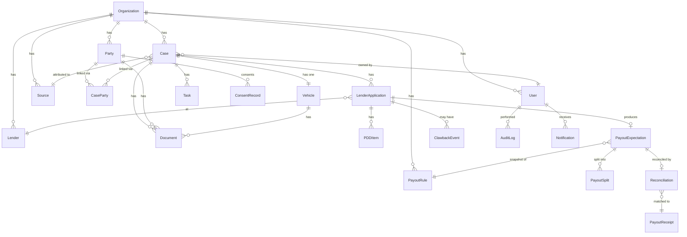

# DSA OS — Data Model

> Source of truth: SRS Section 3.4, Appendix A (Business Rules), Appendix C (State Machines)
>
> All tables carry `org_id` and are protected by PostgreSQL RLS unless noted as platform-level.

---

## 1. Entity Relationship Overview



---

## 2. Core Tables

### 2.1 organizations

Platform-level table. NOT tenant-scoped (no RLS on this table).

| Column | Type | Constraints | Notes |
|---|---|---|---|
| id | UUID (v7) | PK | |
| name | VARCHAR(255) | NOT NULL | |
| slug | VARCHAR(100) | UNIQUE, NOT NULL | URL-friendly identifier |
| gstin | VARCHAR(15) | NULLABLE | GST number, optional |
| pan | VARCHAR(10) | NULLABLE | Org PAN |
| plan | VARCHAR(50) | NOT NULL DEFAULT 'pilot' | |
| settings | JSONB | NOT NULL DEFAULT '{}' | Org-level configuration |
| region | VARCHAR(50) | NOT NULL DEFAULT 'in-west-1' | Hosting region |
| is_active | BOOLEAN | NOT NULL DEFAULT true | |
| created_at | TIMESTAMPTZ | NOT NULL DEFAULT now() | |
| updated_at | TIMESTAMPTZ | NOT NULL DEFAULT now() | |

### 2.2 users

| Column | Type | Constraints | Notes |
|---|---|---|---|
| id | UUID (v7) | PK | |
| org_id | UUID | FK -> organizations, NOT NULL | Tenant key |
| name | VARCHAR(255) | NOT NULL | |
| email | VARCHAR(255) | UNIQUE within org | |
| mobile | VARCHAR(15) | NOT NULL | |
| password_hash | VARCHAR(255) | NOT NULL | Argon2id |
| role | VARCHAR(50) | NOT NULL | owner, manager, processor, field_executive, accountant, auditor |
| team | VARCHAR(100) | NULLABLE | Optional team grouping |
| auth_version | INTEGER | NOT NULL DEFAULT 1 | Incremented on deactivation, role/permission change, or forced logout |
| is_active | BOOLEAN | NOT NULL DEFAULT true | |
| failed_login_count | INTEGER | NOT NULL DEFAULT 0 | |
| locked_until | TIMESTAMPTZ | NULLABLE | Account lockout |
| totp_secret | VARCHAR(255) | NULLABLE | Encrypted, P1 |
| totp_enabled | BOOLEAN | NOT NULL DEFAULT false | |
| last_login_at | TIMESTAMPTZ | NULLABLE | |
| created_at | TIMESTAMPTZ | NOT NULL DEFAULT now() | |
| updated_at | TIMESTAMPTZ | NOT NULL DEFAULT now() | |

**Indexes:** `(org_id, email)` unique, `(org_id, mobile)` unique, `(org_id, role)`

### 2.3 parties

| Column | Type | Constraints | Notes |
|---|---|---|---|
| id | UUID (v7) | PK | |
| org_id | UUID | FK -> organizations, NOT NULL | |
| name | VARCHAR(255) | NOT NULL | |
| mobile_primary | VARCHAR(15) | NOT NULL | |
| mobile_secondary | VARCHAR(15) | NULLABLE | |
| email | VARCHAR(255) | NULLABLE | |
| pan_encrypted | BYTEA | NULLABLE | AES-256 encrypted |
| pan_last_four | VARCHAR(4) | NULLABLE | Indexed for search/dedup |
| aadhaar_last_four | VARCHAR(4) | NULLABLE | Masked storage only (LEG-005) |
| date_of_birth | DATE | NULLABLE | |
| employment_type | VARCHAR(50) | NULLABLE | salaried, self_employed, business, professional, agriculture |
| designation | VARCHAR(100) | NULLABLE | |
| monthly_income | NUMERIC(14,2) | NULLABLE | |
| address_line | VARCHAR(500) | NULLABLE | |
| city | VARCHAR(100) | NULLABLE | |
| state | VARCHAR(100) | NULLABLE | |
| pincode | VARCHAR(6) | NULLABLE | |
| is_deleted | BOOLEAN | NOT NULL DEFAULT false | Soft delete |
| deleted_at | TIMESTAMPTZ | NULLABLE | |
| created_at | TIMESTAMPTZ | NOT NULL DEFAULT now() | |
| updated_at | TIMESTAMPTZ | NOT NULL DEFAULT now() | |

**Indexes:** `(org_id, mobile_primary)`, `(org_id, pan_last_four)`, `(org_id, name)` GIN trigram

### 2.4 sources

| Column | Type | Constraints | Notes |
|---|---|---|---|
| id | UUID (v7) | PK | |
| org_id | UUID | FK -> organizations, NOT NULL | |
| type | VARCHAR(50) | NOT NULL | dealer, sub_dsa, connector, employee, direct, walk_in |
| name | VARCHAR(255) | NOT NULL | |
| contact_name | VARCHAR(255) | NULLABLE | |
| contact_mobile | VARCHAR(15) | NULLABLE | |
| contact_email | VARCHAR(255) | NULLABLE | |
| parent_id | UUID | FK -> sources, NULLABLE | For sub-DSA under aggregator |
| agreement_terms | JSONB | NULLABLE | Split defaults, etc. |
| is_active | BOOLEAN | NOT NULL DEFAULT true | |
| is_deleted | BOOLEAN | NOT NULL DEFAULT false | |
| deleted_at | TIMESTAMPTZ | NULLABLE | |
| created_at | TIMESTAMPTZ | NOT NULL DEFAULT now() | |
| updated_at | TIMESTAMPTZ | NOT NULL DEFAULT now() | |

**Indexes:** `(org_id, type)`, `(org_id, name)`

### 2.5 lenders

| Column | Type | Constraints | Notes |
|---|---|---|---|
| id | UUID (v7) | PK | |
| org_id | UUID | FK -> organizations, NOT NULL | |
| name | VARCHAR(255) | NOT NULL | |
| type | VARCHAR(50) | NOT NULL | bank, nbfc, sfb, hfc |
| products | JSONB | NOT NULL DEFAULT '[]' | Supported product types |
| dsa_code | VARCHAR(100) | NULLABLE | DSA empanelment code |
| notes | TEXT | NULLABLE | |
| is_active | BOOLEAN | NOT NULL DEFAULT true | |
| created_at | TIMESTAMPTZ | NOT NULL DEFAULT now() | |
| updated_at | TIMESTAMPTZ | NOT NULL DEFAULT now() | |

**Indexes:** `(org_id, name)` unique

---

## 3. Case Lifecycle Tables

### 3.1 cases

| Column | Type | Constraints | Notes |
|---|---|---|---|
| id | UUID (v7) | PK | |
| org_id | UUID | FK -> organizations, NOT NULL | |
| case_no | VARCHAR(20) | NOT NULL | Auto-generated, unique per org |
| product | VARCHAR(50) | NOT NULL | new_car, used_car, two_wheeler, commercial_vehicle, tractor, ev, refinance |
| requested_amount | NUMERIC(14,2) | NULLABLE | |
| source_id | UUID | FK -> sources, NOT NULL | BR-02 |
| owner_id | UUID | FK -> users, NOT NULL | BR-02 |
| status | VARCHAR(50) | NOT NULL DEFAULT 'lead' | See state machine |
| entered_stage_at | TIMESTAMPTZ | NOT NULL DEFAULT now() | For SLA/ageing |
| next_action | TEXT | NULLABLE | |
| next_action_due | TIMESTAMPTZ | NULLABLE | |
| consent_status | VARCHAR(50) | NOT NULL DEFAULT 'pending' | pending, recorded, missing |
| version | INTEGER | NOT NULL DEFAULT 1 | Optimistic locking |
| is_deleted | BOOLEAN | NOT NULL DEFAULT false | |
| deleted_at | TIMESTAMPTZ | NULLABLE | |
| created_at | TIMESTAMPTZ | NOT NULL DEFAULT now() | |
| updated_at | TIMESTAMPTZ | NOT NULL DEFAULT now() | |
| created_by | UUID | FK -> users, NOT NULL | |

**Unique:** `(org_id, case_no)`
**Indexes:** `(org_id, status)`, `(org_id, source_id)`, `(org_id, owner_id)`, `(org_id, created_at)`, `(org_id, product)`

### 3.2 case_parties

| Column | Type | Constraints | Notes |
|---|---|---|---|
| id | UUID (v7) | PK | |
| case_id | UUID | FK -> cases, NOT NULL | |
| party_id | UUID | FK -> parties, NOT NULL | |
| role | VARCHAR(50) | NOT NULL | applicant, co_applicant, guarantor, seller |

**Unique:** `(case_id, party_id, role)`
**Check:** at least one applicant enforced at application level (BR-02)

### 3.3 vehicles

| Column | Type | Constraints | Notes |
|---|---|---|---|
| id | UUID (v7) | PK | |
| case_id | UUID | FK -> cases, NOT NULL | Normally one per case |
| condition | VARCHAR(20) | NOT NULL | new, used |
| registration_no | VARCHAR(20) | NULLABLE | Validated format; NULL for new |
| make | VARCHAR(100) | NULLABLE | |
| model | VARCHAR(100) | NULLABLE | |
| variant | VARCHAR(100) | NULLABLE | |
| year_of_manufacture | INTEGER | NULLABLE | |
| chassis_no | VARCHAR(50) | NULLABLE | |
| engine_no | VARCHAR(50) | NULLABLE | |
| fuel_type | VARCHAR(20) | NULLABLE | petrol, diesel, cng, electric, hybrid |
| owner_serial | INTEGER | NULLABLE | 1st, 2nd, etc. for used |
| ex_showroom_price | NUMERIC(14,2) | NULLABLE | |
| on_road_price | NUMERIC(14,2) | NULLABLE | |
| valuation_amount | NUMERIC(14,2) | NULLABLE | |
| valuation_source | VARCHAR(100) | NULLABLE | |
| valuation_date | DATE | NULLABLE | |
| existing_hp_lender | VARCHAR(255) | NULLABLE | |
| existing_hp_status | VARCHAR(50) | NULLABLE | active, closed, unknown |
| existing_hp_source | VARCHAR(100) | NULLABLE | Source of info |
| existing_hp_date | DATE | NULLABLE | |
| created_at | TIMESTAMPTZ | NOT NULL DEFAULT now() | |
| updated_at | TIMESTAMPTZ | NOT NULL DEFAULT now() | |

**Indexes:** `(case_id)`, `(registration_no)` where not null

---

## 4. Document Tables

### 4.1 document_types

Configuration table. Seeded, not tenant-specific (or optionally per-org).

| Column | Type | Constraints | Notes |
|---|---|---|---|
| id | UUID (v7) | PK | |
| code | VARCHAR(50) | UNIQUE, NOT NULL | e.g., pan_card, aadhaar, salary_slip |
| name | VARCHAR(255) | NOT NULL | Display name |
| group_name | VARCHAR(100) | NOT NULL | KYC, Income, Vehicle, Application |
| validity_days | INTEGER | NULLABLE | Auto-expire after N days |
| is_sensitive | BOOLEAN | NOT NULL DEFAULT false | Controls access logging |
| is_active | BOOLEAN | NOT NULL DEFAULT true | |

### 4.2 checklist_rules

Configuration table defining which documents are required for which case characteristics.

| Column | Type | Constraints | Notes |
|---|---|---|---|
| id | UUID (v7) | PK | |
| org_id | UUID | FK -> organizations, NULLABLE | NULL = global default |
| product | VARCHAR(50) | NULLABLE | Matches case.product |
| employment_type | VARCHAR(50) | NULLABLE | Matches party.employment_type |
| vehicle_condition | VARCHAR(20) | NULLABLE | new, used |
| lender_id | UUID | FK -> lenders, NULLABLE | Lender-specific requirement |
| document_type_id | UUID | FK -> document_types, NOT NULL | |
| is_mandatory | BOOLEAN | NOT NULL DEFAULT true | |
| required_by_stage | VARCHAR(50) | NULLABLE | Stage by which doc is needed |
| is_active | BOOLEAN | NOT NULL DEFAULT true | |

### 4.3 documents

| Column | Type | Constraints | Notes |
|---|---|---|---|
| id | UUID (v7) | PK | |
| org_id | UUID | FK -> organizations, NOT NULL | |
| case_id | UUID | FK -> cases, NULLABLE | |
| party_id | UUID | FK -> parties, NULLABLE | |
| vehicle_id | UUID | FK -> vehicles, NULLABLE | |
| document_type_id | UUID | FK -> document_types, NOT NULL | |
| file_key | VARCHAR(500) | NULLABLE | Canonical S3 key; populated ONLY after promotion from quarantine |
| quarantine_key | VARCHAR(500) | NULLABLE | Quarantine S3 key; cleared or retained for audit upon resolution |
| file_name | VARCHAR(255) | NOT NULL | Sanitized original name |
| file_size | INTEGER | NOT NULL | Bytes |
| mime_type | VARCHAR(100) | NOT NULL | Verified MIME type after magic number inspection |
| version | INTEGER | NOT NULL DEFAULT 1 | Document version |
| parent_document_id | UUID | FK -> documents, NULLABLE | Previous version |
| status | VARCHAR(50) | NOT NULL DEFAULT 'quarantined' | quarantined, scanning, scan_failed, received, under_review, verified, rejected, expired, archived |
| scan_result | JSONB | NULLABLE | Scan metadata: {scanner: 'clamav', clean: bool, magic_verified: bool, exif_stripped: bool, scanned_at: ISO8601} |
| scan_error | TEXT | NULLABLE | Error message if validation or scan failed |
| reject_reason | TEXT | NULLABLE | Business rejection reason (when rejected by staff) |
| uploaded_by | UUID | FK -> users, NOT NULL | |
| uploaded_at | TIMESTAMPTZ | NOT NULL DEFAULT now() | |
| verified_by | UUID | FK -> users, NULLABLE | |
| verified_at | TIMESTAMPTZ | NULLABLE | |
| expires_at | TIMESTAMPTZ | NULLABLE | Computed from validity_days |
| is_deleted | BOOLEAN | NOT NULL DEFAULT false | archive = soft delete |
| deleted_at | TIMESTAMPTZ | NULLABLE | |
| created_at | TIMESTAMPTZ | NOT NULL DEFAULT now() | |
| updated_at | TIMESTAMPTZ | NOT NULL DEFAULT now() | |

**Indexes:** `(org_id, case_id)`, `(org_id, party_id)`, `(org_id, status)`, `(document_type_id)`

---

## 5. Lender Application Tables

### 5.1 lender_applications

| Column | Type | Constraints | Notes |
|---|---|---|---|
| id | UUID (v7) | PK | |
| org_id | UUID | FK -> organizations, NOT NULL | |
| case_id | UUID | FK -> cases, NOT NULL | |
| lender_id | UUID | FK -> lenders, NOT NULL | |
| product | VARCHAR(50) | NOT NULL | May differ from case product |
| login_ref | VARCHAR(100) | NULLABLE | Lender reference number |
| login_date | DATE | NULLABLE | |
| status | VARCHAR(50) | NOT NULL DEFAULT 'logged_in' | See state machine |
| query_notes | TEXT | NULLABLE | |
| sanction_amount | NUMERIC(14,2) | NULLABLE | |
| sanction_tenure_months | INTEGER | NULLABLE | |
| sanction_rate | NUMERIC(5,2) | NULLABLE | Annual interest rate |
| sanction_margin_money | NUMERIC(14,2) | NULLABLE | |
| sanction_date | DATE | NULLABLE | |
| rejection_reason_code | VARCHAR(100) | NULLABLE | Required when rejected (BR-04) |
| rejection_notes | TEXT | NULLABLE | |
| disbursal_date | DATE | NULLABLE | |
| disbursal_amount | NUMERIC(14,2) | NULLABLE | |
| disbursal_ref | VARCHAR(100) | NULLABLE | UTR or bank reference |
| disbursal_override_reason | TEXT | NULLABLE | If amount > sanction (BR-08) |
| is_winning | BOOLEAN | NOT NULL DEFAULT false | BR-05: only one per case |
| version | INTEGER | NOT NULL DEFAULT 1 | Optimistic locking |
| created_at | TIMESTAMPTZ | NOT NULL DEFAULT now() | |
| updated_at | TIMESTAMPTZ | NOT NULL DEFAULT now() | |

**Indexes:** `(org_id, case_id)`, `(org_id, lender_id)`, `(org_id, status)`
**Check:** `is_winning = true` only when `status = 'disbursed'`
**Unique partial index:** `CREATE UNIQUE INDEX uq_one_winning_per_case ON lender_applications (org_id, case_id) WHERE is_winning = true;` — enforces BR-05 at the database level: exactly zero or one winning application per case.

### 5.2 pdd_items

| Column | Type | Constraints | Notes |
|---|---|---|---|
| id | UUID (v7) | PK | |
| org_id | UUID | FK -> organizations, NOT NULL | |
| lender_application_id | UUID | FK -> lender_applications, NOT NULL | |
| type | VARCHAR(100) | NOT NULL | rc_hypothecation, insurance_lender_clause, form_34_receipt, etc. |
| description | TEXT | NULLABLE | |
| due_date | DATE | NULLABLE | |
| owner_id | UUID | FK -> users, NULLABLE | |
| status | VARCHAR(50) | NOT NULL DEFAULT 'pending' | pending, submitted, completed, overdue |
| received_date | DATE | NULLABLE | |
| notes | TEXT | NULLABLE | |
| created_at | TIMESTAMPTZ | NOT NULL DEFAULT now() | |
| updated_at | TIMESTAMPTZ | NOT NULL DEFAULT now() | |

**Indexes:** `(org_id, status)`, `(org_id, due_date)`, `(lender_application_id)`

---

## 6. Payout Tables

### 6.1 payout_rules

Effective-dated configuration. Edits create new rows; never modify existing (BR-13).

| Column | Type | Constraints | Notes |
|---|---|---|---|
| id | UUID (v7) | PK | |
| org_id | UUID | FK -> organizations, NOT NULL | |
| lender_id | UUID | FK -> lenders, NOT NULL | |
| product | VARCHAR(50) | NOT NULL | |
| effective_from | DATE | NOT NULL | |
| effective_to | DATE | NULLABLE | NULL = currently active |
| basis | VARCHAR(20) | NOT NULL | percent, flat, slab |
| rate_percent | NUMERIC(6,4) | NULLABLE | For basis = percent |
| flat_amount | NUMERIC(14,2) | NULLABLE | For basis = flat |
| slabs | JSONB | NULLABLE | For basis = slab; array of {min, max, rate} |
| conditions | JSONB | NULLABLE | {ticket_min, ticket_max, vehicle_age_max, segment} |
| gating_condition | VARCHAR(100) | NULLABLE | e.g., pdd_complete |
| clawback_days | INTEGER | NULLABLE | Window in days |
| tds_applicable | BOOLEAN | NOT NULL DEFAULT true | |
| tds_rate | NUMERIC(5,2) | NULLABLE | Default rate, configurable |
| gst_mode | VARCHAR(20) | NULLABLE | forward_charge, reverse_charge, exempt |
| notes | TEXT | NULLABLE | |
| created_by | UUID | FK -> users, NOT NULL | |
| created_at | TIMESTAMPTZ | NOT NULL DEFAULT now() | |
| is_active | BOOLEAN | NOT NULL DEFAULT true | |

**Indexes:** `(org_id, lender_id, product, effective_from)`, `(org_id, effective_to)` where null (active rules)

**Date overlap protection:** For each `(org_id, lender_id, product)` combination, effective date ranges must not overlap. Enforced via an exclusion constraint using `daterange(effective_from, COALESCE(effective_to, 'infinity'::date))` with the `btree_gist` extension:

```sql
ALTER TABLE payout_rules ADD CONSTRAINT no_overlapping_payout_rules
    EXCLUDE USING gist (
        org_id WITH =,
        lender_id WITH =,
        product WITH =,
        daterange(effective_from, COALESCE(effective_to, 'infinity'::date), '[]') WITH &&
    ) WHERE (is_active = true);
```

This guarantees that two active payout rules for the same org+lender+product never cover overlapping dates.

### 6.2 payout_expectations

Created when a lender application reaches Disbursed status.

| Column | Type | Constraints | Notes |
|---|---|---|---|
| id | UUID (v7) | PK | |
| org_id | UUID | FK -> organizations, NOT NULL | |
| lender_application_id | UUID | FK -> lender_applications, NOT NULL, UNIQUE | One per disbursed app |
| rule_id | UUID | FK -> payout_rules, NULLABLE | NULL when no rule |
| rule_snapshot | JSONB | NOT NULL | Frozen copy of the rule (BR-13) |
| disbursal_amount | NUMERIC(14,2) | NOT NULL | |
| expected_gross | NUMERIC(14,2) | NULLABLE | NULL when no rule |
| tds_amount | NUMERIC(14,2) | NULLABLE | |
| gst_amount | NUMERIC(14,2) | NULLABLE | |
| expected_net | NUMERIC(14,2) | NULLABLE | NULL when no rule |
| status | VARCHAR(50) | NOT NULL | no_rule, held, due, received, reconciled, clawed_back |
| gating_met_at | TIMESTAMPTZ | NULLABLE | When gating condition satisfied |
| override_reason | TEXT | NULLABLE | If manually overridden |
| overridden_by | UUID | FK -> users, NULLABLE | |
| overridden_at | TIMESTAMPTZ | NULLABLE | |
| created_at | TIMESTAMPTZ | NOT NULL DEFAULT now() | |
| updated_at | TIMESTAMPTZ | NOT NULL DEFAULT now() | |

**Indexes:** `(org_id, status)`, `(org_id, lender_application_id)` unique

### 6.3 payout_splits

| Column | Type | Constraints | Notes |
|---|---|---|---|
| id | UUID (v7) | PK | |
| org_id | UUID | FK -> organizations, NOT NULL | |
| expectation_id | UUID | FK -> payout_expectations, NOT NULL | |
| beneficiary_type | VARCHAR(50) | NOT NULL | dsa, dealer, sub_dsa, employee |
| beneficiary_id | UUID | NULLABLE | FK -> sources or users |
| beneficiary_name | VARCHAR(255) | NOT NULL | Denormalized for display |
| basis | VARCHAR(20) | NOT NULL | percentage, flat |
| share_percent | NUMERIC(6,4) | NULLABLE | |
| share_amount | NUMERIC(14,2) | NULLABLE | Computed |
| is_paid | BOOLEAN | NOT NULL DEFAULT false | |
| paid_at | TIMESTAMPTZ | NULLABLE | |
| created_at | TIMESTAMPTZ | NOT NULL DEFAULT now() | |
| updated_at | TIMESTAMPTZ | NOT NULL DEFAULT now() | |

**Check:** SUM(share_percent) for an expectation at most 100% (BR-09, enforced in service)

### 6.4 payout_receipts

Imported from lender statements or entered manually.

| Column | Type | Constraints | Notes |
|---|---|---|---|
| id | UUID (v7) | PK | |
| org_id | UUID | FK -> organizations, NOT NULL | |
| lender_id | UUID | FK -> lenders, NOT NULL | |
| statement_ref | VARCHAR(255) | NULLABLE | Statement file reference |
| import_batch_id | UUID | NULLABLE | Groups rows from one import |
| loan_account_no | VARCHAR(100) | NULLABLE | For matching |
| customer_name | VARCHAR(255) | NULLABLE | For matching |
| receipt_date | DATE | NOT NULL | |
| gross_amount | NUMERIC(14,2) | NOT NULL | |
| tds_amount | NUMERIC(14,2) | NULLABLE | |
| net_amount | NUMERIC(14,2) | NOT NULL | |
| matched_case_id | UUID | FK -> cases, NULLABLE | NULL = unmatched |
| matched_expectation_id | UUID | FK -> payout_expectations, NULLABLE | |
| match_status | VARCHAR(50) | NOT NULL DEFAULT 'unmatched' | matched, short, excess, unmatched, clawed_back |
| notes | TEXT | NULLABLE | |
| created_at | TIMESTAMPTZ | NOT NULL DEFAULT now() | |
| updated_at | TIMESTAMPTZ | NOT NULL DEFAULT now() | |

**Indexes:** `(org_id, lender_id)`, `(org_id, match_status)`, `(org_id, loan_account_no)`, `(import_batch_id)`

### 6.5 reconciliations

| Column | Type | Constraints | Notes |
|---|---|---|---|
| id | UUID (v7) | PK | |
| org_id | UUID | FK -> organizations, NOT NULL | |
| expectation_id | UUID | FK -> payout_expectations, NOT NULL | |
| receipt_id | UUID | FK -> payout_receipts, NULLABLE | NULL for manual |
| result | VARCHAR(50) | NOT NULL | matched, short, excess, missing, manual |
| variance_amount | NUMERIC(14,2) | NULLABLE | |
| resolution_note | TEXT | NULLABLE | |
| resolved_by | UUID | FK -> users, NULLABLE | |
| resolved_at | TIMESTAMPTZ | NULLABLE | |
| created_at | TIMESTAMPTZ | NOT NULL DEFAULT now() | |
| updated_at | TIMESTAMPTZ | NOT NULL DEFAULT now() | |

### 6.6 clawback_events

| Column | Type | Constraints | Notes |
|---|---|---|---|
| id | UUID (v7) | PK | |
| org_id | UUID | FK -> organizations, NOT NULL | |
| lender_application_id | UUID | FK -> lender_applications, NOT NULL | |
| reason | TEXT | NOT NULL | |
| clawback_date | DATE | NOT NULL | |
| amount | NUMERIC(14,2) | NOT NULL | |
| status | VARCHAR(50) | NOT NULL DEFAULT 'pending' | pending, confirmed, disputed, reversed |
| notes | TEXT | NULLABLE | |
| created_at | TIMESTAMPTZ | NOT NULL DEFAULT now() | |
| updated_at | TIMESTAMPTZ | NOT NULL DEFAULT now() | |

---

## 7. Workflow and Tracking Tables

### 7.1 status_history

| Column | Type | Constraints | Notes |
|---|---|---|---|
| id | UUID (v7) | PK | |
| org_id | UUID | FK -> organizations, NOT NULL | |
| entity_type | VARCHAR(50) | NOT NULL | case, lender_application, document, pdd_item |
| entity_id | UUID | NOT NULL | |
| from_status | VARCHAR(50) | NOT NULL | |
| to_status | VARCHAR(50) | NOT NULL | |
| changed_by | UUID | FK -> users, NOT NULL | |
| note | TEXT | NULLABLE | Override reason, etc. |
| created_at | TIMESTAMPTZ | NOT NULL DEFAULT now() | |

**Indexes:** `(org_id, entity_type, entity_id)`, `(org_id, created_at)`

### 7.2 tasks (follow-ups)

| Column | Type | Constraints | Notes |
|---|---|---|---|
| id | UUID (v7) | PK | |
| org_id | UUID | FK -> organizations, NOT NULL | |
| case_id | UUID | FK -> cases, NULLABLE | |
| lender_application_id | UUID | FK -> lender_applications, NULLABLE | |
| action | TEXT | NOT NULL | What needs to be done |
| owner_id | UUID | FK -> users, NOT NULL | |
| due_date | TIMESTAMPTZ | NOT NULL | |
| status | VARCHAR(50) | NOT NULL DEFAULT 'pending' | pending, completed, cancelled |
| completed_at | TIMESTAMPTZ | NULLABLE | |
| notes | TEXT | NULLABLE | |
| created_at | TIMESTAMPTZ | NOT NULL DEFAULT now() | |
| updated_at | TIMESTAMPTZ | NOT NULL DEFAULT now() | |

**Indexes:** `(org_id, owner_id, status)`, `(org_id, due_date)`, `(org_id, case_id)`

---

## 8. Privacy and Consent Tables

### 8.1 consent_records

| Column | Type | Constraints | Notes |
|---|---|---|---|
| id | UUID (v7) | PK | |
| org_id | UUID | FK -> organizations, NOT NULL | |
| party_id | UUID | FK -> parties, NOT NULL | |
| purpose | VARCHAR(100) | NOT NULL | processing_kyc, sharing_with_lenders, contacting_customer |
| notice_version | VARCHAR(20) | NOT NULL | |
| channel | VARCHAR(50) | NOT NULL | in_person, digital, phone |
| captured_by | UUID | FK -> users, NOT NULL | |
| captured_at | TIMESTAMPTZ | NOT NULL DEFAULT now() | |
| withdrawn_at | TIMESTAMPTZ | NULLABLE | |
| withdrawn_by | UUID | FK -> users, NULLABLE | |

**Indexes:** `(org_id, party_id)`, `(org_id, purpose)`

### 8.2 data_subject_requests (P1)

| Column | Type | Constraints | Notes |
|---|---|---|---|
| id | UUID (v7) | PK | |
| org_id | UUID | FK -> organizations, NOT NULL | |
| party_id | UUID | FK -> parties, NOT NULL | |
| request_type | VARCHAR(50) | NOT NULL | access, correction, erasure |
| status | VARCHAR(50) | NOT NULL DEFAULT 'received' | received, in_progress, completed, rejected |
| due_date | DATE | NOT NULL | |
| completed_at | TIMESTAMPTZ | NULLABLE | |
| notes | TEXT | NULLABLE | |
| created_at | TIMESTAMPTZ | NOT NULL DEFAULT now() | |

---

## 9. Audit and Notification Tables

### 9.1 audit_log

Append-only. Application role has INSERT + SELECT only.

| Column | Type | Constraints | Notes |
|---|---|---|---|
| id | UUID (v7) | PK | |
| org_id | UUID | NOT NULL | Not FK (performance) |
| actor_id | UUID | NOT NULL | |
| actor_role | VARCHAR(50) | NOT NULL | |
| action | VARCHAR(100) | NOT NULL | e.g., case.status_changed, document.viewed |
| entity_type | VARCHAR(50) | NOT NULL | |
| entity_id | UUID | NOT NULL | |
| before_state | JSONB | NULLABLE | Sensitive fields hashed |
| after_state | JSONB | NULLABLE | Sensitive fields hashed |
| ip_address | INET | NULLABLE | |
| user_agent | VARCHAR(500) | NULLABLE | |
| reason | TEXT | NULLABLE | For overrides |
| created_at | TIMESTAMPTZ | NOT NULL DEFAULT now() | |

**Indexes:** `(org_id, created_at)`, `(org_id, actor_id)`, `(org_id, entity_type, entity_id)`, `(org_id, action)`

### 9.2 notifications

| Column | Type | Constraints | Notes |
|---|---|---|---|
| id | UUID (v7) | PK | |
| org_id | UUID | FK -> organizations, NOT NULL | |
| user_id | UUID | FK -> users, NOT NULL | |
| event_type | VARCHAR(100) | NOT NULL | |
| title | VARCHAR(255) | NOT NULL | |
| body | TEXT | NOT NULL | |
| entity_type | VARCHAR(50) | NULLABLE | For deep-linking |
| entity_id | UUID | NULLABLE | |
| channel | VARCHAR(50) | NOT NULL DEFAULT 'in_app' | |
| status | VARCHAR(50) | NOT NULL DEFAULT 'pending' | pending, delivered, read, failed |
| delivered_at | TIMESTAMPTZ | NULLABLE | |
| read_at | TIMESTAMPTZ | NULLABLE | |
| created_at | TIMESTAMPTZ | NOT NULL DEFAULT now() | |

**Indexes:** `(org_id, user_id, status)`, `(org_id, user_id, created_at)`

---

## 10. Session and Configuration Tables

### 10.1 refresh_tokens

| Column | Type | Constraints | Notes |
|---|---|---|---|
| id | UUID (v7) | PK | |
| user_id | UUID | FK -> users, NOT NULL | |
| token_hash | VARCHAR(255) | NOT NULL, UNIQUE | Hashed opaque token |
| expires_at | TIMESTAMPTZ | NOT NULL | |
| revoked_at | TIMESTAMPTZ | NULLABLE | |
| created_at | TIMESTAMPTZ | NOT NULL DEFAULT now() | |
| ip_address | INET | NULLABLE | |

### 10.2 sla_configs

| Column | Type | Constraints | Notes |
|---|---|---|---|
| id | UUID (v7) | PK | |
| org_id | UUID | FK -> organizations, NOT NULL | |
| entity_type | VARCHAR(50) | NOT NULL | case, lender_application |
| status | VARCHAR(50) | NOT NULL | |
| sla_hours | INTEGER | NOT NULL | |
| is_active | BOOLEAN | NOT NULL DEFAULT true | |

**Unique:** `(org_id, entity_type, status)`

### 10.3 status_transitions

Configuration table for allowed transitions.

| Column | Type | Constraints | Notes |
|---|---|---|---|
| id | UUID (v7) | PK | |
| org_id | UUID | FK -> organizations, NULLABLE | NULL = system default |
| entity_type | VARCHAR(50) | NOT NULL | case, lender_application, document |
| from_status | VARCHAR(50) | NOT NULL | |
| to_status | VARCHAR(50) | NOT NULL | |
| requires_reason | BOOLEAN | NOT NULL DEFAULT false | |
| requires_role | VARCHAR(50) | NULLABLE | Min role for this transition |

---

## 11. Statement Import Tables

### 11.1 statement_column_mappings

| Column | Type | Constraints | Notes |
|---|---|---|---|
| id | UUID (v7) | PK | |
| org_id | UUID | FK -> organizations, NOT NULL | |
| lender_id | UUID | FK -> lenders, NOT NULL | |
| name | VARCHAR(255) | NOT NULL | |
| mapping | JSONB | NOT NULL | Column name -> field mapping |
| created_at | TIMESTAMPTZ | NOT NULL DEFAULT now() | |

### 11.2 import_batches

| Column | Type | Constraints | Notes |
|---|---|---|---|
| id | UUID (v7) | PK | |
| org_id | UUID | FK -> organizations, NOT NULL | |
| type | VARCHAR(50) | NOT NULL | statement, parties, cases |
| file_name | VARCHAR(255) | NOT NULL | |
| total_rows | INTEGER | NOT NULL | |
| valid_rows | INTEGER | NOT NULL | |
| invalid_rows | INTEGER | NOT NULL | |
| status | VARCHAR(50) | NOT NULL | pending, dry_run, imported, reversed |
| error_file_key | VARCHAR(500) | NULLABLE | S3 key for error file |
| imported_by | UUID | FK -> users, NOT NULL | |
| imported_at | TIMESTAMPTZ | NULLABLE | |
| reversible_until | TIMESTAMPTZ | NULLABLE | 24 hours after import |
| created_at | TIMESTAMPTZ | NOT NULL DEFAULT now() | |

---

## 12. Sensitive Fields Summary

| Table | Field | Protection |
|---|---|---|
| parties | pan_encrypted | AES-256 (Fernet), only pan_last_four indexed |
| parties | aadhaar_last_four | Stored as last 4 only; never stored in full |
| parties | mobile_primary | Masked in API responses for non-permitted roles |
| parties | monthly_income | Masked in API responses for non-permitted roles |
| users | password_hash | Argon2id, never returned in API |
| users | totp_secret | AES-256 encrypted |
| lender_applications | disbursal_amount | Visible only to Owner, Manager, Accountant |
| payout_expectations | All money fields | Visible only to Owner, Accountant, Auditor |
| audit_log | before_state / after_state | Sensitive values hashed before storage |

---

## 13. State Machines (from SRS Appendix C)

### Case Status

```
Lead -> Screening -> Collecting Docs -> Docs Complete -> Applied
Applied -> Sanctioned -> Pre-disbursal -> Disbursed -> Post-disbursal
Post-disbursal -> Payout Pending -> Payout Received -> Closed

Exits:
  Lead..Applied            -> Customer Dropped (reason required)
  Applied                  -> All Rejected -> Rework -> Applied | Closed
  Sanctioned/Pre-disbursal -> Cancelled
  Disbursed or later       -> Cancelled after disbursal (opens clawback review)

Backward:
  Docs Complete -> Collecting Docs (document rejected or expires, reason required)
```

### Lender Application Status

```
Logged In -> Under Verification <-> Query Raised
Under Verification -> Sanctioned -> Accepted by Customer -> Disbursed

Exits:
  Rejected (reason code required)
  Declined by Customer
  Cancelled
```

### Document Status (Quarantine Pipeline)

```
Upload lifecycle:
  quarantined → scanning → received (validation passed)
  quarantined → scanning → scan_failed (validation failed)

Business lifecycle (post-validation):
  received → under_review → verified | rejected
  rejected → (new upload creates new document version)
  Any → expired (automatic by validity)
  Any → archived
```

### Document Download Authorization by Status

| Status | Download Allowed? | Notes |
|---|---|---|
| `quarantined` | **NO** | File is in quarantine zone; never serve |
| `scanning` | **NO** | Validation in progress |
| `scan_failed` | **NO** | File failed validation; quarantine object deleted |
| `received` | **YES** | File promoted to canonical zone |
| `under_review` | **YES** | File is in canonical zone |
| `verified` | **YES** | File is in canonical zone |
| `rejected` | **YES** | File remains accessible for reference |
| `expired` | **YES** | File remains accessible (expiry is a workflow flag) |
| `archived` | **YES** (Owner/Manager only) | Soft-deleted; restricted access |

**Invariant:** The download API MUST check `document.status NOT IN ('quarantined', 'scanning', 'scan_failed')` before generating any signed URL.

### Payout Expectation Status

```
(Disbursed) → No rule | Held → Due → Received → Reconciled
Received/Reconciled → Clawed back (within clawback window)
```
